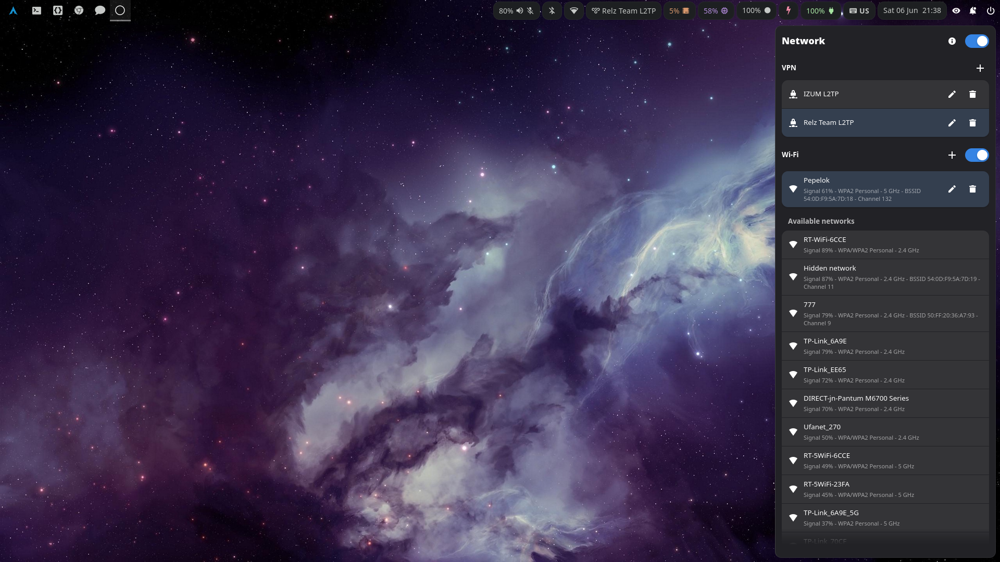

# Network Manager Sidebar



Native GTK4/libadwaita NetworkManager sidebar for Wayland desktops. Opens as a right-side panel from the CLI, app launchers, hotkeys, or Waybar.

## Features

- View Ethernet status and disconnect wired connections.
- Scan and connect to Wi-Fi networks, enter passwords, and toggle Wi-Fi or global networking.
- Import, create, edit, connect, disconnect, and remove VPN and NetworkManager WireGuard profiles.
- Import, replace, connect, disconnect, and remove AmneziaWG profiles.
- Inspect connection details, including addresses, routes, DNS, and Wi-Fi information.

## Installation

On Arch Linux, install [`nm-sidebar`](https://aur.archlinux.org/packages/nm-sidebar) from the AUR.

Prebuilt packages are also available in [GitHub Releases](https://github.com/Relz/network-manager-sidebar/releases): Debian/Ubuntu (`.deb`), Fedora/RHEL-family (`.rpm`), Arch Linux (`.pkg.tar.zst`), or Alpine Linux (`.apk`).

Requires a Wayland compositor with layer-shell support and these dependencies:

- GTK4, libadwaita 1.6+, and `gtk4-layer-shell`.
- GLib/GIO 2.68+ and JSON-GLib 1.6+.
- NetworkManager/libnm 1.40+ and `nm-connection-editor` from network-manager-applet 1.32+.
- System D-Bus, `polkit-gobject-1`, and the polkit authority daemon.

For AmneziaWG, follow the [additional setup below](#amneziawg).

## Usage

```sh
nm-sidebar                # Toggle the sidebar (same as --toggle)
nm-sidebar --show         # Show the sidebar
nm-sidebar --hide         # Hide the sidebar
nm-sidebar --quit         # Quit the running instance
nm-sidebar --reload-css   # Reload user CSS
nm-sidebar --background   # Start hidden if not already running
nm-sidebar --help         # Show available options
```

`--toggle`, `--show`, and `--background` start the app if needed. Other control commands require a running instance. Add `nm-sidebar --background` to your session startup to preload the app.

### Waybar and monitors

Add an `on-click` entry to your Waybar module:

```json
{
  "on-click": "nm-sidebar --toggle"
}
```

Waybar's `WAYBAR_OUTPUT_NAME` selects the output automatically. Override it with `NM_SIDEBAR_OUTPUT=eDP-1 nm-sidebar --toggle`.

### Custom styles

Put CSS overrides in `$XDG_CONFIG_HOME/nm-sidebar/nm-sidebar.css` (default: `~/.config/nm-sidebar/nm-sidebar.css`), then run `nm-sidebar --reload-css`.

## VPN and WireGuard

The VPN group lists saved VPN and WireGuard profiles together. **Import** opens a local configuration in `nm-connection-editor`, which detects WireGuard and VPN formats supported by installed VPN plugins. **+ → VPN/WireGuard** creates a profile; **Edit** opens a saved one.

WireGuard requires kernel support but works without VPN plugins, `wg-quick`, or a sidebar-specific helper. Unlike plugin-based VPNs, activation does not require an existing active connection.

- WireGuard import requires `nm-connection-editor` 1.32+ [built against libnm 1.40+](https://github.com/NetworkManager/network-manager-applet/blob/main/src/connection-editor/connection-helpers.c).
- An active WireGuard row means the interface is configured, not that a peer handshake or traffic succeeds.
- NetworkManager imports supported settings without executing `wg-quick` hooks. AmneziaWG-specific configurations belong in the separate AmneziaWG group.

## AmneziaWG

Install `awg-quick` separately to use AmneziaWG. It must be in `/usr/bin`, `/usr/sbin`, `/bin`, or `/sbin`; copies under `/usr/local` are not used. Profiles with `DNS=` need `systemd-resolved` or a supported `resolvconf` installation. Firewall inspection also requires tools for the relevant backends: `nft`, `iptables-save`, and/or `ip6tables-save`.

Access is denied by default, so the AmneziaWG section stays hidden until a local polkit rule grants access. The app does not prompt for an administrator password.

As an administrator, create `/etc/polkit-1/rules.d/49-nm-sidebar-amneziawg.rules` as a root-owned `0644` file, replacing `YOUR_USER` with the allowed login name:

```javascript
polkit.addRule(function(action, subject) {
    if (action.id == "dev.relz.NmSidebar.manage-amneziawg" &&
        subject.user == "YOUR_USER" &&
        subject.local &&
        subject.active) {
        return polkit.Result.YES;
    }
});
```

Polkit reloads rules automatically, and the sidebar updates access without a restart.

AmneziaWG behavior and limitations:

- Profiles are stored in `/etc/amnezia/amneziawg/`.
- Imports accept local regular files up to 1 MiB, excluding symlinks. Command hooks (`PreUp`, `PostUp`, `PreDown`, `PostDown`) and domain-only `DNS=` values are unsupported.
- `awg` validates protocol compatibility during activation.
- User operations take priority over background refreshes and run one at a time.
- Switching disconnects previous sidebar-managed AmneziaWG sessions before connecting the target. If activation fails, previous sessions are not automatically restored.
- Failed runtime cleanup prevents profile removal. Externally managed interfaces and tunnels requiring manual intervention remain blocked.
- Tunnels are not configured to start automatically at boot.

## Development

Install Meson, Ninja, pkg-config, a C compiler, and development headers for the dependencies above. Configure once:

```sh
meson setup build --prefix=/usr --libdir=lib --buildtype=debugoptimized
```

Then build, install, and check the CLI:

```sh
meson compile -C build
sudo meson install -C build
nm-sidebar --help
```

## License

GNU General Public License v3.0 or later. See [LICENSE](LICENSE).
